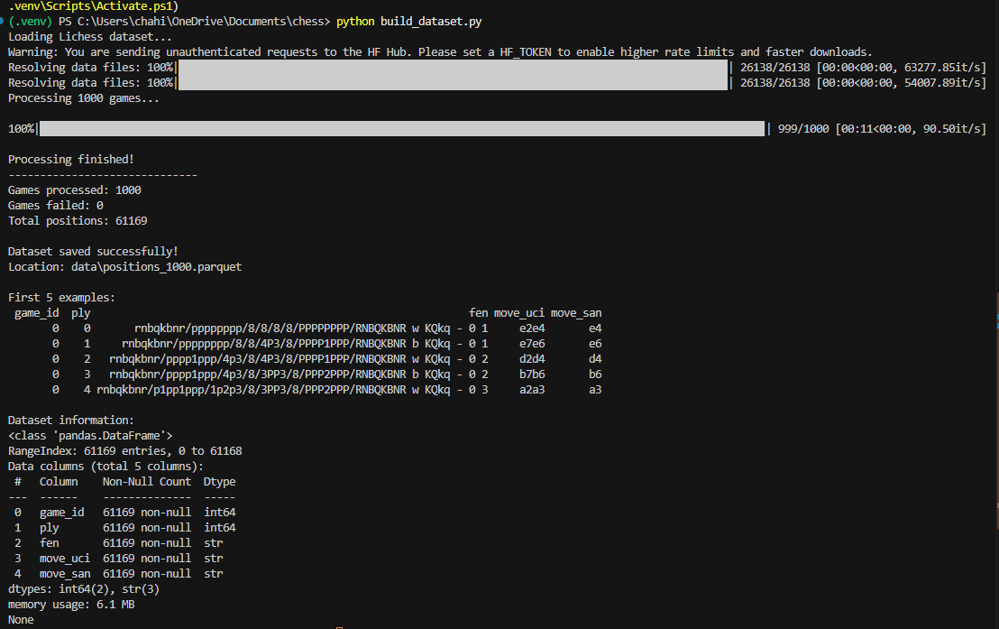
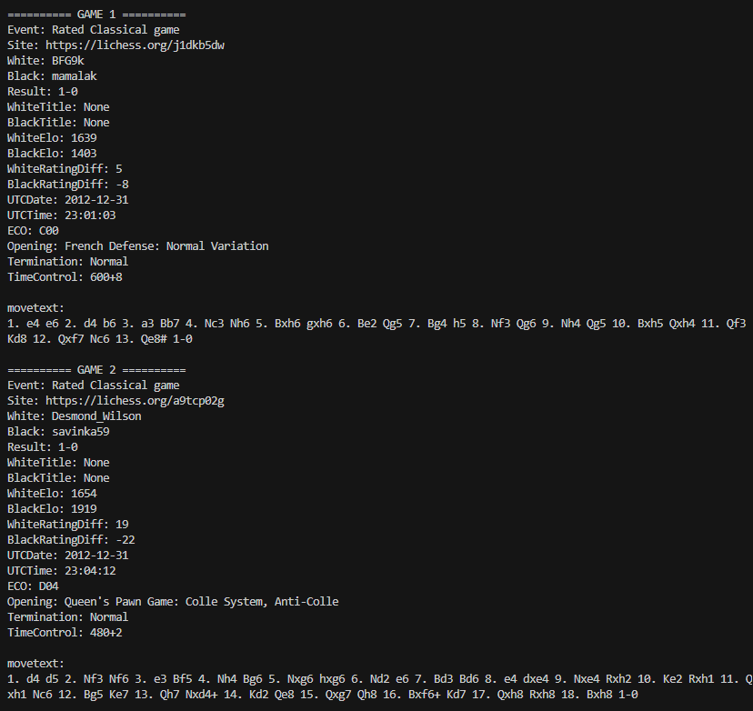
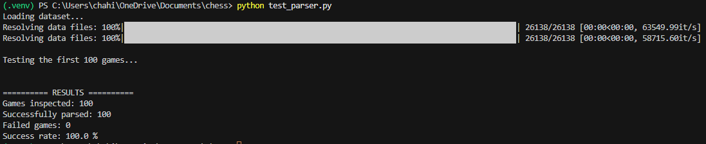
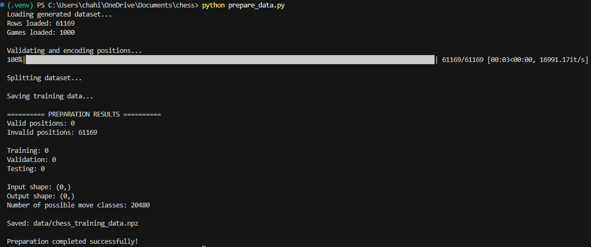

# Chess Engine - Machine Learning Project

A chess engine built for machine learning research. This repository contains the initial dataset inspection and processing pipeline.

## Overview

This project explores using machine learning to improve chess engine decision-making. The approach involves:

1. **Dataset Collection**: Gathering large volumes of chess games from Lichess API
2. **Data Processing**: Cleaning and structuring game data for ML training
3. **Model Training**: Developing neural networks to evaluate positions and suggest moves
4. **Engine Integration**: Combining ML models with traditional chess evaluation

## Setup

### Prerequisites

- Python 3.11+
- Git

### Installation

```bash
# Create virtual environment
py -3.11 -m venv .venv

# Activate
# Windows: .\.venv\Scripts\Activate.ps1
# Linux/Mac: source .venv/bin/activate

# Install dependencies
pip install -r requirements.txt
```

### Dependencies

Key packages:
- `datasets` - Loading and processing large chess datasets
- `python-chess` - Chess board representation and move parsing
- `pandas` - Data manipulation and analysis
- `pyarrow` - Efficient data serialization
- `tqdm` - Progress bars for long operations

## Dataset Inspection

The project includes tools for exploring chess datasets:

### `inspect_dataset.py`

Explores chess game datasets to understand:
- Game length distributions
- Opening patterns
- Player ratings
- Move statistics

### `test_parser.py`

Validates move parsing functionality:
- SAN (Standard Algebraic Notation) parsing
- Move legality verification
- Board state reconstruction

### `build_dataset.py`

Processes raw chess data into ML-ready format:
- Fetches games from Lichess API
- Validates API connectivity
- Structures data for training pipelines

## Screenshots

The following screenshots document the dataset inspection and preparation process:


*Dataset structure and build pipeline output*


*API connectivity validation results*


*Move parser test cases and validation*


*Data preprocessing pipeline for ML training*

## Project Structure

```
chess-engine/
├── README.md              # This file
├── requirements.txt       # Python dependencies
├── .gitignore            # Git ignore rules
├── inspect_dataset.py    # Dataset exploration script
├── test_parser.py        # Parser validation tests
├── build_dataset.py      # Dataset processing pipeline
└── screenshots/          # Documentation images
    ├── dataset-build.png
    ├── dataset-conection-test.png
    └── parsetest.png
```

## Next Steps

- Implement chess engine core logic (board representation, move generation)
- Develop position evaluation functions
- Integrate ML model training pipeline
- Add unit tests for engine components

## License

MIT License - feel free to use and modify for your own machine learning experiments.
